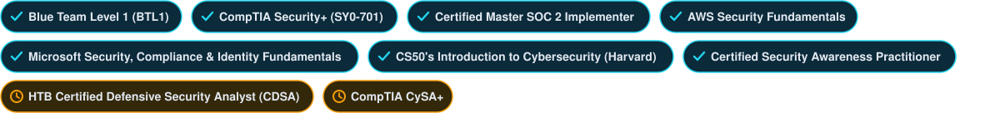
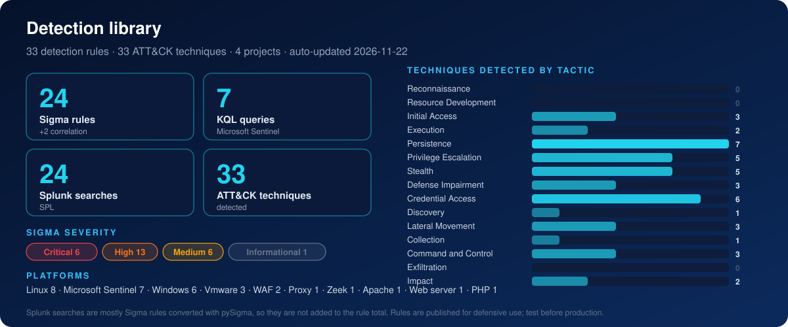

Cybersecurity portfolio focused on **threat intelligence, detection engineering and incident response**, mapped to MITRE ATT&CK, ATT&CK for ICS, ATLAS and SPARTA.

## 🎓 Certifications

✓ certified · ◷ in progress

## 🗺️ MITRE ATT&CK Coverage

This map updates itself every day from the ATT&CK Navigator layers in my project repositories.

## 🛡️ Detection Library

Every Sigma, KQL and Splunk rule published in my repositories, counted automatically every day.

## 🔐 Projects

This list updates itself every day from my public repositories.

<!-- PROJECTS:START -->
| Project | Description | Topics |
|---|---|---|
| [sandworm-ukraine-grid-ics-attacks](https://github.com/PARTSI14/sandworm-ukraine-grid-ics-attacks) | Sandworm vs Ukraine's power grid 2016-2022: Industroyer, Industroyer2 and the MicroSCADA LotL attack. ATT&CK for ICS + Enterprise layers (v20.1), 9 Sigma rules + Splunk, IOCs. | `ics-security` `industroyer` `mitre-attack-ics` `ot-security` `sandworm` `scada` |
| [armory-castle-vcenter-detections](https://github.com/PARTSI14/armory-castle-vcenter-detections) | Detection engineering for the Armory Castle vCenter zero-day (CVE-2026-123890, Nov 2026): 13 Sigma rules + Splunk SPL, ATT&CK v20.1 layer, hunting & hardening checklist for vSphere. | `cybersecurity` `detection-engineering` `mitre-attack` `sigma` `splunk` `threat-hunting` |
| [hospital-ransomware-nis2-playbook](https://github.com/PARTSI14/hospital-ransomware-nis2-playbook) | Hospital ransomware incident response playbook with NIS2 24h/72h/1-month reporting, templates, ATT&CK v20.1 baseline and Sigma detections. Case study: Greiz-Ronneburg, Nov 2026 | `cybersecurity` `gdpr` `healthcare` `incident-response` `mitre-attack` `nis2` |
| [cs50-cybersecurity-final-project](https://github.com/PARTSI14/cs50-cybersecurity-final-project) | CS50 Cybersecurity (Harvard) final project: case study of the January 2025 DeepSeek ClickHouse database exposure, with video presentation. | `cs50` `cybersecurity` `data-breach` `database-security` `deepseek` `harvard` |
| [connectwise-m365-kql-detections](https://github.com/PARTSI14/connectwise-m365-kql-detections) | KQL detections for Microsoft Sentinel against the Storm-0940 / ConnectWise Cloud Backup supply-chain attack on Microsoft 365 (Oct 2026): app-identity abuse, role self-assignment, secret planting, response playbook and ATT&CK mapping. | `cybersecurity` `detection-engineering` `entra-id` `kql` `microsoft-sentinel` `mitre-attack` |
| [eu-commission-ai-cyberattack-2026](https://github.com/PARTSI14/eu-commission-ai-cyberattack-2026) | Threat intelligence assessment of the AI-assisted cyberattack on the European Commission (Oct–Nov 2026): key judgements with confidence levels, ATT&CK mapping, competing hypotheses and a hunting checklist for AI-driven intrusions | `ai-security` `cti` `cybersecurity` `incident-analysis` `mitre-attack` `threat-hunting` |
| [php2shell-detection-engineering](https://github.com/PARTSI14/php2shell-detection-engineering) | Detection engineering for PHP2Shell (CVE-2026-109618 / CVE-2026-109619): Sigma rules with Splunk queries, a patch-or-isolate response playbook and a MITRE ATT&CK mapping. | `cybersecurity` `detection-engineering` `incident-response` `mitre-attack` `php` `sigma` |
| [eu-cold-chain-sabotage-2026](https://github.com/PARTSI14/eu-cold-chain-sabotage-2026) | Analysis of the 2026 European refrigeration sabotage campaign (France, Oct–Nov 2026), mapped to MITRE ATT&CK for ICS and Enterprise, with SOC detection opportunities and countermeasures (NIST 800-53, ISO 27001). | `critical-infrastructure` `cybersecurity` `ics-security` `iso27001` `mitre-attack` `mitre-attack-ics` |
| [ka-sat-sparta-analysis](https://github.com/PARTSI14/ka-sat-sparta-analysis) | Threat analysis of the 2022 Viasat KA-SAT cyberattack, mapped to SPARTA and MITRE ATT&CK, with SOC detection opportunities and countermeasures (NIST 800-53, ISO 27001). | `cyberattack-analysis` `cybersecurity` `iso27001` `mitre-attack` `nist-800-53` `satellite` |
<!-- PROJECTS:END -->

## 🛠️ Skills

Threat Intelligence · Detection Engineering · Incident Response · MITRE ATT&CK / ICS / ATLAS · SPARTA · Sigma · KQL · Splunk SPL · NIS2 · GDPR

## 📫 Contact
[LinkedIn](https://www.linkedin.com/in/stelios-partsinevelos-03bab297) · [Hack The Box](https://profile.hackthebox.com/profile/019f2d58-8d00-73a8-90a1-81812e161e24)

