Cybersecurity portfolio focused on **threat intelligence, detection engineering and incident response**, mapped to MITRE ATT&CK, ATT&CK for ICS, ATLAS and SPARTA.

## ⭐ Featured project

<a href="https://github.com/PARTSI14/detection-as-code">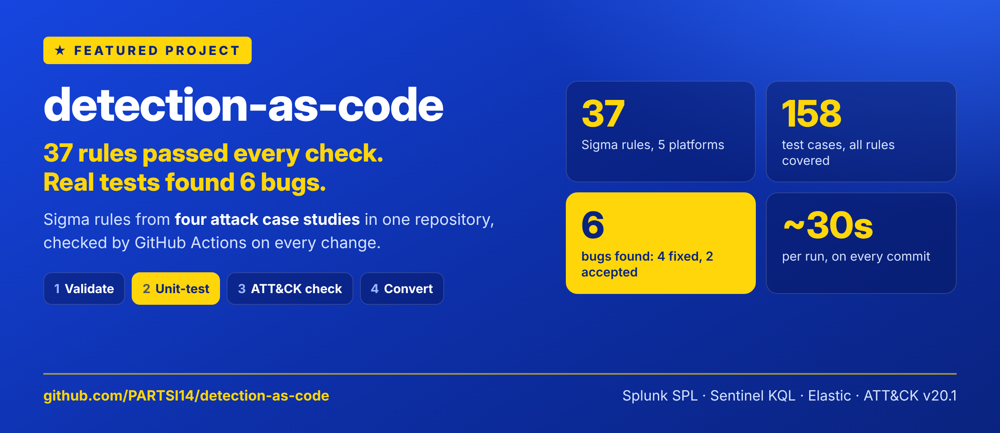</a>
## 🎓 Certifications

✓ certified · ◷ in progress

## 🔐 Projects

Click a card to open the project. This list updates itself every day from my public repositories.

<!-- PROJECTS:START -->

<a href="https://github.com/PARTSI14/detection-as-code">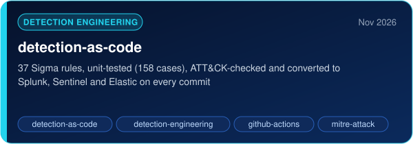</a>
<a href="https://github.com/PARTSI14/sandworm-ukraine-grid-ics-attacks">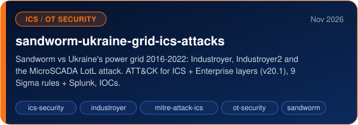</a>
<a href="https://github.com/PARTSI14/armory-castle-vcenter-detections">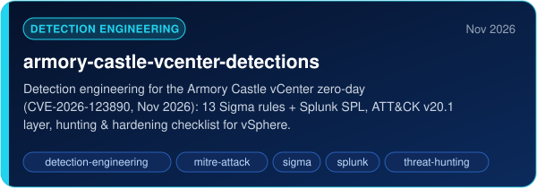</a>
<a href="https://github.com/PARTSI14/hospital-ransomware-nis2-playbook">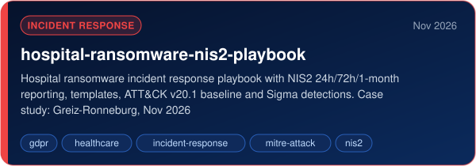</a>
<a href="https://github.com/PARTSI14/cs50-cybersecurity-final-project">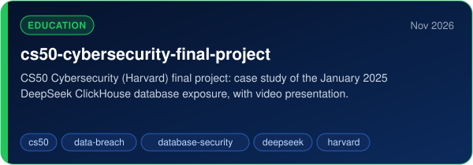</a>
<a href="https://github.com/PARTSI14/connectwise-m365-kql-detections">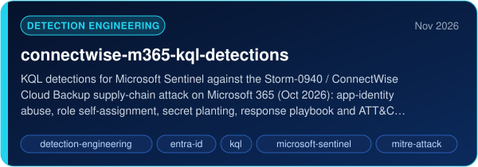</a>
<a href="https://github.com/PARTSI14/eu-commission-ai-cyberattack-2026">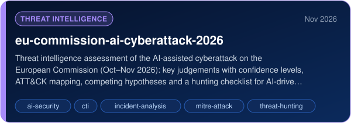</a>
<a href="https://github.com/PARTSI14/php2shell-detection-engineering">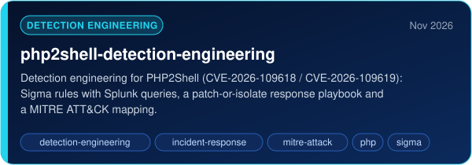</a>
<a href="https://github.com/PARTSI14/eu-cold-chain-sabotage-2026">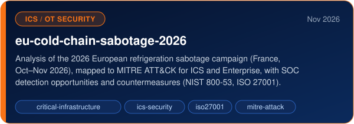</a>
<a href="https://github.com/PARTSI14/ka-sat-sparta-analysis">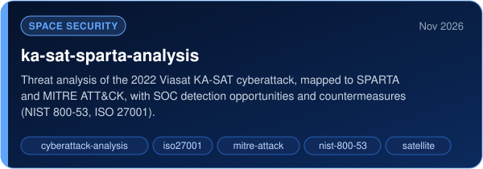</a>

<!-- PROJECTS:END -->

## 🗺️ MITRE ATT&CK Coverage

This map updates itself every day from the ATT&CK Navigator layers in my project repositories.

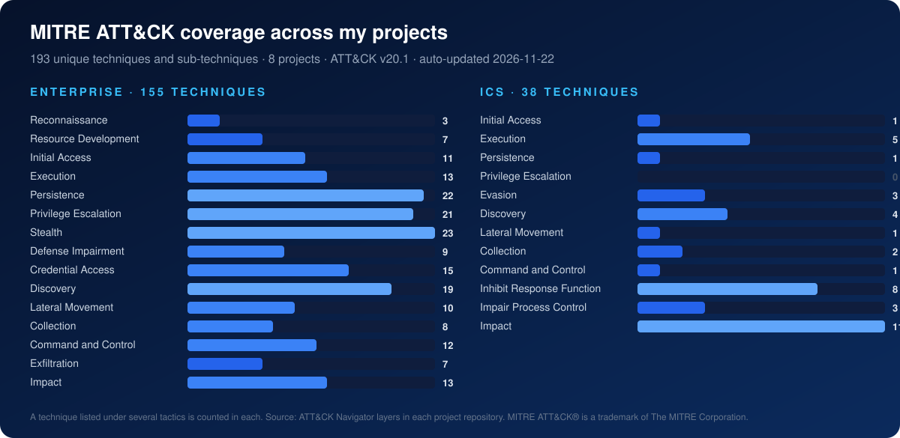

## 🛡️ Detection Library

Every Sigma, KQL and Splunk rule published in my repositories, counted automatically every day.

## 🛠️ Skills

Threat Intelligence · Detection Engineering · Incident Response · MITRE ATT&CK / ICS / ATLAS · SPARTA · Sigma · KQL · Splunk SPL · NIS2 · GDPR

## 📫 Contact
[LinkedIn](https://www.linkedin.com/in/stelios-partsinevelos-03bab297) · [Hack The Box](https://profile.hackthebox.com/profile/019f2d58-8d00-73a8-90a1-81812e161e24)

Banner, emblem and profile graphics © 2026 Stelios Partsinevelos. All rights reserved. Not covered by the MIT license of my project repositories.

